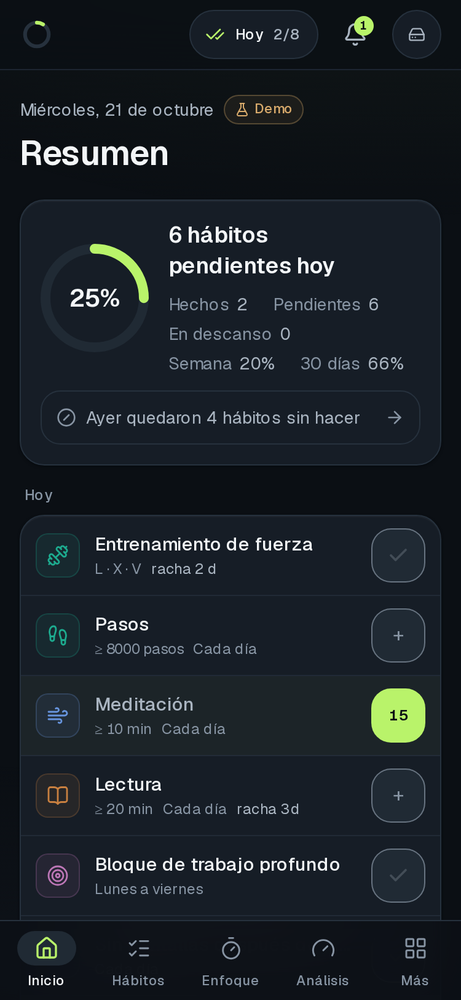
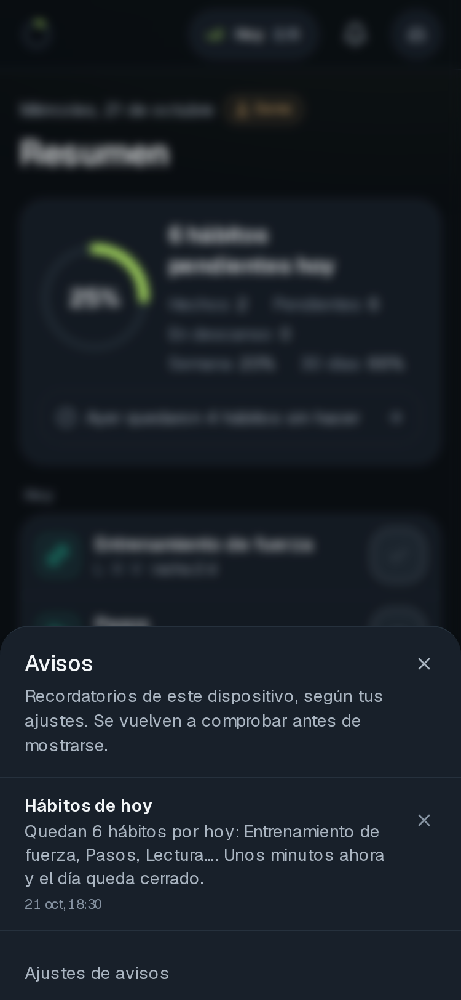

# Guía de uso

Cómo se usa THE ONE PERCENT en el día a día. Las capturas están en [`screenshots/`](screenshots/), en versión móvil (375 px) y escritorio, y salen de la demo con el reloj fijo en el miércoles 21 de octubre de 2026 (`npm run screenshots`). Para probar en un iPhone real: [`guia-dispositivo.md`](guia-dispositivo.md).

## Entrar

- **Con cuenta:** escribe tu email en `/login` y pulsa «Enviar enlace de acceso». Abre el enlace del correo o escribe el código de 6 dígitos. Solo entran los emails autorizados: no hay registro público.
- **Demo:** explora sin cuenta con datos de ejemplo guardados solo en ese navegador. Todo lo que viene de la demo lleva la etiqueta «Demo». Desde Ajustes puedes llevar a tu cuenta hábitos de la demo («Importar desde la demo»).
- **Instalar en el móvil:** en iPhone, Safari → Compartir → «Añadir a pantalla de inicio». Instalada, la app arranca también sin conexión en un dispositivo que ya la abrió con red, y en iPhone es la única forma de recibir notificaciones push.

## El día: Resumen (`/`)

El Resumen dice qué requiere atención hoy y distingue cuatro situaciones que podrían parecer «nada hecho»:

| Lo que ves | Qué significa |
| --- | --- |
| «Empieza por tu primer hábito» | Aún no hay datos: no es un 0 %. |
| «Hoy es día de descanso planificado» | Descanso decidido: no cuenta como incumplimiento ni baja ningún porcentaje. |
| «N hábitos pendientes hoy», con hechos, pendientes y en descanso | Día normal; lo pendiente aún puede hacerse. |
| «Ayer quedaron N hábitos sin hacer» | Incumplimiento de ayer, contado aparte. El enlace lleva a la matriz para registrarlo tarde si se te olvidó apuntarlo. |
| Aviso «No se pudo sincronizar» | Error del servidor: ves la copia de este dispositivo, tus cambios esperan aquí y «Reintentar» los envía. |

Debajo están la lista de hoy (un toque marca un hábito; los numéricos piden la cantidad), los atajos (Hábitos, Repaso con su contador, Revisiones y Analytics), el check-in que toca, la revisión pendiente, «Empezar bloque» de Enfoque, el tema de hoy y lo que estás leyendo. Al final, el cumplimiento de 30 días por dimensión y los objetivos activos.

## Hábitos (`/habits`)

- **Crear:** «Nuevo hábito». Puede ser binario (hecho o no), numérico (p. ej. ≥ 8000 pasos) o de duración. La frecuencia es cada día, unos días de la semana o N veces por semana. Cuenta desde el día en que lo creas y solo los días programados.
- **Registrar:** en «Hoy» o en la matriz semanal (en móvil, «Semana»). Un día pasado se puede registrar tarde.
- **Día de descanso:** en la matriz, toca la cabecera del día → «Marcar como descanso». Ese día no cuenta en ninguna métrica.
- **Editar o archivar:** desde el nombre del hábito. Cambiar la frecuencia no altera las semanas anteriores. El historial de cambios del hábito está en su ficha.
- Los hábitos alimentados por Enfoque (p. ej. «Deep Work 90 min») se completan solos con los minutos de tus sesiones.

## Objetivos (`/goals`)

«Nuevo objetivo»: por hábitos (sostenerlos por encima de un umbral), por una cifra que mides tú o calculado con los registros de un hábito, con fecha e hitos. También se le pueden vincular libros. Su ficha muestra el avance y su ritmo, y guarda obstáculos y ajustes. El filtro separa activos, en revisión, cerrados (conseguidos o abandonados) y archivo.

## Enfoque (`/focus`)

Elige 25, 50 o 90 minutos y «Empezar». Se puede pausar, y al terminar se anotan, si quieres, el proyecto y las interrupciones. Si cierras la app con un bloque en marcha, al volver se recupera. Las estadísticas de concentración están en la misma pantalla y en Analytics.

## Mente (`/mind`)

Check-in de mañana y de noche (sueño, energía, ánimo, estrés y una nota), en unos pocos toques y sin botón de guardar. La tira de «Últimos 7 días» muestra qué días tienen cada check-in; pulsa un día para verlo o editarlo. Nunca hay diagnósticos.

## Revisiones (`/reviews`)

Diarias, semanales y mensuales:
- La **diaria** tiene las cifras del día, «¿Qué has observado?» y «¿Qué vas a ajustar?».
- La **semanal** y la **mensual** recorren cifras, dificultades, reflexión y decisiones.

Al cerrar una revisión, sus cifras quedan congeladas tal como eran ese día. Las decisiones se siguen en el registro de decisiones (`/reviews/decisions`).

## Conocimiento

- **Biblioteca** (`/knowledge/library`): «Añadir libro», «Añadir programa» o «Añadir episodio». La búsqueda asistida (Open Library, Apple Podcasts) rellena los datos y puedes revisarlos antes de guardar; también hay formulario manual. Cada ficha guarda el estado, el progreso, la valoración, las notas y las ideas, y permite «buscar y actualizar datos» después sin pisar lo que escribiste.
- **Cerebro** (`/knowledge/brain`): todas tus notas e ideas, con búsqueda y filtros. **Repaso** (`/knowledge/brain/repaso`) es el repaso espaciado: crea una tarjeta desde una idea, y al repasar responde «Otra vez», «Difícil», «Bien» o «Fácil». Funciona sin conexión.
- **Descubrir** (`/knowledge/discover`): un tema al día, igual en todos tus dispositivos. Puedes valorarlo de 1 a 10, guardarlo o descartarlo, y escribir tus propios temas. Los temas incluidos son síntesis sin verificar y así se indica.

## Análisis

- **Analytics** (`/analytics`): cumplimiento, tendencias, comparativas de semanas y meses cerrados, relaciones entre variables y proyección de la semana siguiente. Cada cifra abre los registros de los que sale. Las relaciones exigen un mínimo de días y nunca se presentan como causa.
- **Inteligencia** (`/intelligence`): hallazgos calculados con reglas («Reglas · sin IA»), cada uno con su periodo, sus variables y su número de datos, y experimentos de 7 a 28 días que se comparan con los mismos días anteriores. La IA generativa está apagada: necesitaría un proveedor de pago no autorizado.

## Avisos (`/settings/notifications`)

- **Bandeja** (la campana): recordatorios según tus ajustes (tono, máximo diario, separación mínima, horas de silencio, días sin avisos y qué avisos quieres). Antes de mostrarse se vuelve a comprobar si ya hiciste el hábito o si es día de descanso.
- **Push en este dispositivo:** «Activar en este dispositivo» pide el permiso del navegador solo en ese momento. Cada dispositivo se activa y desactiva por separado, y desde la lista puedes quitar otro (un móvil perdido). Al cerrar sesión, ese navegador deja de recibir push.
  - «Enviar prueba» manda una **notificación de prueba** a ese dispositivo.
  - Los recordatorios llegan además por push cuando el envío programado está activado en el servidor (E9; cómo activarlo, en `docs/publicacion.md` §5). Se vuelven a comprobar en el momento del envío con las mismas reglas que la bandeja, y en la pantalla de bloqueo solo dicen cuántos hábitos quedan, nunca sus nombres. Mientras no esté activado, llegan solo a la bandeja.
  - En un servidor sin claves VAPID, la sección lo dice y no ofrece activar.

## Sin conexión y varios dispositivos

- Lo que registras sin conexión se guarda en el dispositivo y se envía una sola vez al volver la red. El indicador de la cabecera («Estado de datos») dice si está sincronizado, pendiente, sin conexión o con error.
- Si dos dispositivos cambian lo mismo, gana el cambio más reciente. En los textos largos (reflexiones, notas) la app te muestra el conflicto para que elijas, sin perder ninguna versión.
- «Hoy» sigue la zona horaria de tu perfil (Ajustes → Zona horaria), igual en todos tus dispositivos, y corrige la hora del dispositivo con la del servidor.

## Ajustes (`/settings`)

Zona horaria, exportación, diagnóstico de sincronización y «Cerrar sesión». «Exportar mis datos (JSON)» descarga todo. «CSV: hábitos», «CSV: check-ins» y «CSV: enfoque» descargan cada tipo de registro en un fichero para hojas de cálculo: separado por comas, con las fechas en tu zona y los instantes en UTC. Al cerrar sesión puedes elegir «Borrar los datos de este dispositivo», recomendado en dispositivos compartidos. Si hay cambios sin enviar, la app te avisa antes de borrarlos.
